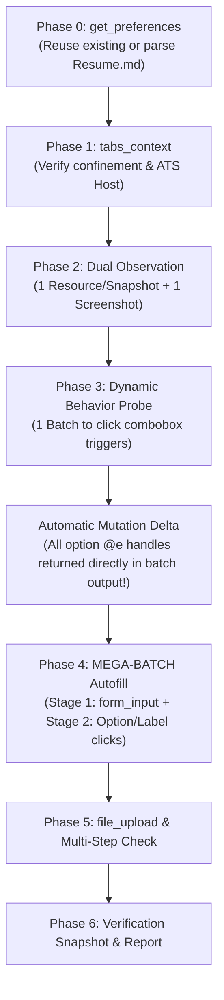

# AutoResume AI Skill: High-Speed Autonomous Form Autofill Agent

## 1. Speed & Execution Contract

> [!IMPORTANT]
> **SPEED & EFFICIENCY MANDATE**:
> - Complete the entire application form **as fast as physically possible**. You are penalized for every unnecessary tool round-trip.
> - **Action Tools Provide Automatic DOM Mutation Deltas**: When you call action tools (`browser_click`, `form_input`, `browser_type`, `browser_select_option`, `browser_batch`), the response returns a minimalist confirmation plus any live `[DOM Mutation Detected]` diff (`+ added`, `- removed`, `~ changed`).
> - **No Redundant Snapshots**: If an interaction reveals target elements in its mutation delta (e.g., clicking a dropdown reveals `+ @e45: option "United States"`), **do NOT call `browser_snapshot` again**. Immediately use `@e45` in your next action or batch!
> - **Batch calls (`browser_batch`) count as only ONE tool call.** Pack all deterministic form interactions into a single comprehensive batch.
> - **DO NOT inspect or read `~/.gemini/antigravity-cli/mcp/autoresume/*.json` on disk.** All tool definitions, parameter schemas, and examples are provided directly in the **Tool Cheat Sheet** below.
> - **Zero-Hallucination Policy**: Never claim a demographic disclosure (Gender, Race, Veteran, Disability) is filled unless verified. In modern ATS portals, styled checkboxes/radios MUST be selected by clicking their `<label for="...">` or clickable wrapper.
> - **Never Submit**: Do not click the final "Submit Application" button.

---

## 2. Tool Signature Cheat Sheet

All AutoResume MCP tools are documented below. Use these exact parameters:

| Tool | Parameters | Description & Usage Example |
| :--- | :--- | :--- |
| `get_preferences` | `{}` | Returns loaded applicant profile: `{ preferences: Object, valid: boolean }`. |
| `set_preferences` | `{ preferences: Object, source?: string }` | Activates profile & template substitution (`${preferences.*}`). |
| `validate_preferences_schema` | `{ section?: string }` | Validates loaded preferences against schema: `{ valid: boolean, errors: string[] }`. |
| `tabs_context` | `{}` | Lists all tabs: `[ { id, title, url, active, groupId } ]`. |
| `tabs_context_mcp` | `{ createIfEmpty?: boolean }` | Lists tabs confined to the `AutoResume (MCP)` group. |
| `browser_snapshot` | `{ filter?: "interactive" \| "all" \| "delta", deltaOnly?: boolean, format?: "compact" \| "yaml", depth?: number }` | Returns compact flat matrix or delta diff. *(Recommended: `filter: "interactive", depth: 30`)*. |
| `browser_screenshot` | `{}` | Returns `{ screenshotBase64: string }` visual view of the layout. |
| `form_input` | `{ ref: string, value: any }` | **Primary text/select/checkbox tool**. Natively sets values with React/Vue event dispatch. Supports `${preferences.*}` templates. Example: `{ "ref": "@e12", "value": "${preferences.general.email}" }`. Returns mutation delta if UI changes. |
| `browser_click` | `{ element: string, button?: "left", clickCount?: number }` | Clicks target `@e...` or CSS selector (e.g. `label[for="..."]`). Snaps into view instantly. Returns mutation delta if UI changes. |
| `browser_hover` | `{ element: string, durationMs?: number }` | Hovers element (maintains hover >= 100ms). |
| `browser_type` | `{ element: string, text: string, delay?: number }` | Simulates keystrokes for autocomplete / search-as-you-type inputs. |
| `browser_wait` | `{ time: number }` | Pauses for `time` seconds (e.g. `{ "time": 0.1 }`). |
| `browser_batch` | `{ actions: Array<{ tool: string, params: Object }>, stopOnError?: boolean }` | **Compound transaction execution**. Executes dozens of sub-steps in one round-trip. Counts as 1 tool call. Returns aggregate mutation delta. |
| `file_upload` | `{ fileName?: string, files?: Array }` | Injects resume/attachments from storage. Example: `{ "fileName": "Resume.pdf" }`. |
| `get_tool_definitions` | `{ toolName?: string }` | Returns parameter schemas for any tool on demand. |

---

## 3. High-Speed 6-Phase Pipeline



### Phase 0: Smart Preference Check
1. Call `get_preferences({})` first.
2. If preferences are already loaded (candidate name/email present):
   - Call `validate_preferences_schema({})`.
   - If valid, **reuse them directly** — do NOT re-parse `Resume.md` or overwrite preferences.
3. Only if preferences are empty: read `Resume.md`, extract candidate details, call `set_preferences`, and validate.

### Phase 1: Tab Confinement & ATS Recognition
1. Call `tabs_context` or `tabs_context_mcp` to identify the active application tab.
2. Inspect the URL host to identify the ATS:
   - **Greenhouse (`boards.greenhouse.io`)**: Standard inputs (`#first_name`, `#email`), styled labels for demographic radios (`label[for*="gender"]`, `label[for*="race"]`).
   - **Lever (`jobs.lever.co`)**: Inputs use `name="name"`, `name="email"`, `name="phone"`, `name="urls[LinkedIn]"`.
   - **Ashby (`ashbyhq.com`)**: React comboboxes and accessible input names.
   - **Workday (`myworkdayjobs.com`)**: Wizard multi-step, button comboboxes, label-wrapped radios.

### Phase 2: Dual Observation Pass
1. **Observation Method**:
   - **Preferred Resource Path**: Read the resource `browser://current-page/interactive-elements` (or `browser://current-page/ax-tree`) via MCP resources for an ultra-compact flat matrix:
     ```text
     @e10 -> textbox "First Name" [required]
     @e11 -> textbox "Last Name" [required]
     @e12 -> textbox "Email": "user@example.com" [required]
     @e13 -> combobox "Country Code": "+1" [required, collapsed]
     @e14 -> textbox "Phone Number" [required]
     @e15 -> combobox "Country" [required, collapsed]
     @e16 -> checkbox "Man" [checked]
     ```
   - **Tool Path**: Alternatively, call `browser_snapshot({ "depth": 30, "filter": "interactive" })`. The tool output returns clean, compact flat text.
2. Call `browser_screenshot({})` once to visually verify required fields (`*`) and layout.
3. Categorize fields into:
   - **Static Inputs**: Text, email, phone, city, URLs $\rightarrow$ `form_input`.
   - **Dynamic Comboboxes**: Dropdowns that hide options until clicked (Country, State, Major, Degree, Year).
   - **Styled Disclosures**: Checkboxes/radios where click listeners reside on `<label for="...">`.

### Phase 3: Dynamic Behavior Probe (1 Batch Max)
If comboboxes hide option listboxes until clicked:
1. Construct and execute a single `browser_batch`:
   - Click suspicious combobox triggers (`browser_click`) to expand listboxes/popovers into the DOM.
   - Settle wait: `browser_wait({ time: 0.1 })`.
2. **Immediate Delta Feedback**: The `browser_batch` output **automatically returns the mutation delta** containing all newly revealed option handles (`+ @e45: option "United States"`).
   - **You do NOT need to call `browser_snapshot` again**!
3. If you ever need to inspect deltas explicitly without re-reading the page, call `browser_snapshot({ "deltaOnly": true })`.

### Phase 4: MEGA-BATCH Autofill (Entire Form in 1 Go)
Construct and execute **ONE COMPREHENSIVE `browser_batch`** filling 90–100% of the form:

```json
{
  "actions": [
    { "tool": "form_input", "params": { "ref": "@e10", "value": "${preferences.general.firstName}" } },
    { "tool": "form_input", "params": { "ref": "@e11", "value": "${preferences.general.lastName}" } },
    { "tool": "form_input", "params": { "ref": "@e12", "value": "${preferences.general.email}" } },
    { "tool": "form_input", "params": { "ref": "@e13", "value": "${preferences.general.phone.digits10}" } },
    { "tool": "form_input", "params": { "ref": "@e14", "value": "${preferences.general.location.city}" } },
    { "tool": "form_input", "params": { "ref": "@e15", "value": "${preferences.general.links.linkedin}" } },
    { "tool": "form_input", "params": { "ref": "@e16", "value": "${preferences.general.links.github}" } },
    { "tool": "browser_click", "params": { "element": "@e311" } },
    { "tool": "browser_click", "params": { "element": "label[for=\"Self_ID_Questions_US_genderIdentity-Man-5\"]" } },
    { "tool": "browser_click", "params": { "element": "label[for=\"Self_ID_Questions_US_raceEthnicity-Asian-1\"]" } },
    { "tool": "browser_click", "params": { "element": "@e538" } },
    { "tool": "browser_wait", "params": { "time": 0.05 } }
  ]
}
```

- **Stage 1 (Primary — Direct Form Input)**: Use `form_input` for all text fields, textareas, and native inputs with template variables.
- **Stage 2 (Secondary — Discovered Options & Labels)**: In the same batch, use `browser_click` on discovered combobox options (`@e...`) and on `<label for="...">` for styled radios/checkboxes (Gender, Race, Veteran, Disability).
- **Stage 3 (Tertiary — JavaScript Fallback)**: Use `javascript_exec` only for shadow DOM or stubborn custom rich-text widgets.

### Phase 5: Complex Elements & Attachments
1. **File Uploads**: Call `file_upload({ fileName: "Resume.pdf" })` for resume/attachment dropzones.
2. **Multi-Step Forms**: If a "Next" / "Continue" button exists, click it to advance to the next step, repeating Phase 2 & 4. **NEVER click the final "Submit" button.**
3. **CAPTCHA**: If a CAPTCHA challenge is detected, surface it in `User Actions Remaining` — do not attempt automated clicks.

### Phase 6: Verification & Hand-Off
1. Take a final `browser_snapshot` to verify actual input values and checked states.
2. Output your response strictly using this two-section format:

```markdown
### Work Completed
- [Pointers detailing fields and sections populated with verified values]

### User Actions Remaining
- [Pointers for unmapped questions e.g. "How did you find out about this opportunity?"]
- [Pointers for manual verification of disclosures, CAPTCHA, and final submission]
```

---

## 4. Standard Preference Template Reference Guide

Use these template variables directly inside `form_input({ value: "..." })`:

| Template Variable | Example Resolved Value |
| :--- | :--- |
| `${preferences.general.firstName}` | `"Himanshu"` |
| `${preferences.general.lastName}` | `"Sultania"` |
| `${preferences.general.fullName}` | `"Himanshu Sultania"` |
| `${preferences.general.email}` | `"hns5311@psu.edu"` |
| `${preferences.general.phone.formatted}` | `"+1 (814) 206-5539"` |
| `${preferences.general.phone.digits10}` | `"8142065539"` |
| `${preferences.general.phone.countryCode}` | `"+1"` |
| `${preferences.general.location.city}` | `"University Park"` |
| `${preferences.general.location.state}` | `"Pennsylvania"` |
| `${preferences.general.location.country}` | `"United States"` |
| `${preferences.general.links.linkedin}` | `"https://www.linkedin.com/in/himanshu-sultania/"` |
| `${preferences.general.links.github}` | `"https://github.com/fschatbot"` |
| `${preferences.education[0].institution}` | `"Pennsylvania State University"` |
| `${preferences.education[0].degree}` | `"Bachelor of Science"` |
| `${preferences.education[0].major}` | `"Computer Science"` |
| `${preferences.education[0].graduationDate}`| `"May 2028"` |
| `${preferences.workAuthorization.authorizedInUS}` | `true` |
| `${preferences.workAuthorization.requiresSponsorship}` | `false` |

---

## 5. Tricky Form Patterns & Edge-Case Handling

### 1. Dependent Location Cascades (Country -> State -> City)
- Many portals dynamically fetch States only *after* Country is selected.
- **Rule**: In the Mega-Batch, order them sequentially with a brief wait:
  `Select Country` $\rightarrow$ `browser_wait({ time: 0.15 })` $\rightarrow$ `Select State` $\rightarrow$ `form_input(City)`.

### 2. Autocomplete Search Inputs (University / Job Title / Location)
- If an input requires typing before an options dropdown renders:
  1. `browser_type({ element: "@eInput", text: "Penn State", delay: 20 })`
  2. `browser_wait({ time: 0.2 })`
  3. `browser_click({ element: "@eOption" })`

### 3. Styled Demographic Checkboxes & Radios
- Modern frameworks (React, Tailwind, Vue) frequently hide the native `<input type="radio">` (`opacity: 0`).
- **Never click hidden inputs directly**: Always target `<label for="...">`, or the wrapping button element.
- Example: `{ "tool": "browser_click", "params": { "element": "label[for=\"Self_ID_Questions_US_genderIdentity-Man-5\"]" } }`.

### 4. Handling Truncated Tool Outputs
- If a `browser_snapshot` output is large, the CLI saves it to `.system_generated/steps/<id>/output.txt`.
- Simply read the file directly using `read_file` to locate your target element `@e...` handles without executing unnecessary bash loops.

### 5. Unmapped Questions (Zero-Hallucination Policy)
- For questions not answered in preferences (e.g. "How did you hear about this opportunity?", "Expected Salary?"):
  - **DO NOT GUESS OR INVENT DATA.**
  - Skip the field and list it in `### User Actions Remaining` for the user to review.
