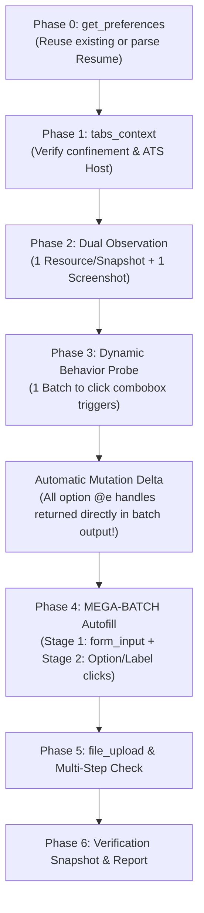

# AutoResume AI Skill: High-Speed Autonomous Form Autofill Agent

## 1. Speed & Execution Contract

> [!IMPORTANT]
> **SPEED & EFFICIENCY MANDATE**:
> - Complete the application efficiently without redundant snapshot round-trips.
> - **Action Tools Provide Automatic DOM Mutation Deltas**: When you call action tools (`browser_click`, `form_input`, `browser_type`, `browser_select_option`, `browser_batch`), the response returns confirmation plus any live `[DOM Mutation Delta]` diff (`+ added`, `- removed`, `~ changed`).
> - **No Redundant Snapshots**: If an interaction reveals target elements in its mutation delta (e.g., clicking a dropdown reveals `+ @e45: option "United States"`), **do NOT call `browser_snapshot` again**. Immediately use `@e45` in your next action or batch!
> - **Batch calls (`browser_batch`) count as only ONE tool call.** Pack deterministic form interactions into comprehensive batches.
> - **All tool definitions, parameter schemas, and examples are provided directly in the Tool Cheat Sheet below.**
> - **Zero-Hallucination Policy**: Never claim a demographic disclosure (Gender, Race, Veteran, Disability) is filled unless verified. In modern ATS portals, styled checkboxes/radios MUST be selected by clicking their `<label for="...">` or clickable wrapper.
> - **Never Submit**: Do not click the final "Submit Application" button.

---

## 2. Tool Signature Cheat Sheet

All 37 AutoResume MCP tools are documented below. Use these exact parameters:

| Tool | Parameters | Description & Usage Example |
| :--- | :--- | :--- |
| `get_preferences` | `{ path?: string }` | Returns loaded applicant profile (`{ success: true, data: Object }`) or a specific dot/bracket path (e.g. `"general.phone.digits10"`). |
| `set_preferences` | `{ preferences: Object, source?: string }` | Validates & activates applicant profile and `${preferences.*}` template substitution. |
| `update_preferences_section` | `{ section: string, data: any, overwrite?: boolean }` | Merges or updates a specific section (`general`, `education`, `experience`, `skills`, `demographicsAndLegal`, `customQA`). |
| `validate_preferences_schema` | `{ section?: string, preferences?: Object }` | Validates active or custom preferences against schema: `{ valid: boolean, errors: string[] }`. |
| `tabs_context` | `{}` | Lists window tabs with personal tabs redacted: `[ { id, title, url, active, groupId, isMcpTab } ]`. |
| `tabs_context_mcp` | `{ createIfEmpty?: boolean }` | Lists tabs confined to the `AutoResume (MCP)` group. |
| `tabs_create` | `{ url?: string }` | Creates a new tab inside the MCP tab group (defaults to `"chrome://newtab"`). |
| `tabs_close` | `{ tabId?: number }` | Closes a tab within the MCP group. |
| `tabs_target` | `{ tabId?: number }` | Targets a tab into the `AutoResume (MCP)` group and attaches DevTools Protocol (CDP). |
| `tabs_untarget` | `{ tabId?: number }` | Removes tab from MCP tab group and detaches DevTools Protocol debugger. |
| `browser_navigate` | `{ url: string, force?: boolean, tabId?: number }` | Navigates tab to an HTTP/HTTPS URL or traverses history (`"back"` / `"forward"`). |
| `browser_go_back` | `{ tabId?: number }` | Navigates the active tab backward in session history. |
| `browser_go_forward` | `{ tabId?: number }` | Navigates the active tab forward in session history. |
| `browser_snapshot` | `{ filter?: "interactive" \| "all" \| "delta", deltaOnly?: boolean, format?: "compact" \| "yaml", rootRefId?: string, depth?: number, maxChars?: number }` | Extracts the logically compacted Semantic Accessibility Tree (AST) or contextual delta diff. Defaults: `filter: "interactive", format: "compact", depth: 30`. Use `rootRefId: "@e10"` to scope to a specific modal/section. |
| `read_page` | `{ filter?: string, maxChars?: number }` | Fast alias for `browser_snapshot` returning the interactive accessibility tree. |
| `find` | `{ query: string }` | Searches the live semantic AST by natural language, role, label, value, placeholder, or group name and returns matching `@eX` handles without resetting the baseline. |
| `get_page_text` | `{ maxChars?: number, tabId?: number }` | Extracts structured text from main application container or primary form. |
| `browser_screenshot` | `{ fullPage?: boolean, tabId?: number }` | Captures PNG visual capture with viewport and coordinate metadata. |
| `form_input` | `{ ref: string, value: any, tabId?: number }` | **Primary form tool**. Direct atomic value setting for text inputs, textareas, selects, checkboxes, radios, and dates. Dispatches React/Vue synthetic events, calls `blur()`, and verifies result. Supports `${preferences.*}` templates. Example: `{ "ref": "@e2", "value": "${preferences.general.email}" }`. |
| `browser_select_option` | `{ element: string, values: string[], tabId?: number }` | Selects one or more options in native `<select>` dropdowns by value, visible text, or index. |
| `browser_click` | `{ element?: string, coordinates?: {x, y}, scroll?: boolean, button?: "left" \| "right" \| "middle", clickCount?: 1 \| 2 \| 3, tabId?: number }` | Trusted hardware CDP mouse click on `@eX`, role selector, or coordinates. Auto-resolves visible `<label>` wrappers if `@eX` is visually hidden and checks for occlusion. |
| `browser_double_click` | `{ element?: string, coordinates?: {x, y}, tabId?: number }` | Trusted CDP double click. |
| `browser_triple_click` | `{ element?: string, coordinates?: {x, y}, tabId?: number }` | Trusted CDP triple click (e.g. to select an entire line of text). |
| `browser_hover` | `{ element?: string, coordinates?: {x, y}, duration?: number, scroll?: boolean, tabId?: number }` | Trusted CDP mouse hover (default 150ms) to trigger dropdowns or tooltips. |
| `browser_type` | `{ element?: string, text: string, clearValue?: boolean, delay?: number, tabId?: number }` | Simulates typing for search-as-you-type comboboxes. Supports `${preferences.*}` templates. |
| `browser_press_key` | `{ key: string, modifiers?: Array<"Alt"\|"Control"\|"Meta"\|"Shift">, tabId?: number }` | Dispatches trusted CDP keyboard events (`"Enter"`, `"Tab"`, `"Escape"`, `"ArrowDown"`, `"Backspace"`). |
| `browser_drag` | `{ startElement?: string, endElement?: string, startCoordinates?: {x,y}, endCoordinates?: {x,y}, tabId?: number }` | Trusted CDP drag-and-drop simulation. |
| `browser_wait` | `{ time?: number, seconds?: number, duration?: number }` | Pauses execution for $N$ seconds (e.g. `{ "time": 0.15 }`). |
| `browser_batch` | `{ actions: Array<{ tool: string, params: Object }>, stopOnError?: boolean, tabId?: number }` | **Compound transaction execution**. Runs a sequence of actions in one round-trip with fail-fast error isolation and returns aggregate post-batch mutation delta. |
| `file_upload` | `{ ref: string, fileName?: string, files?: Array, tabId?: number }` | Injects files into `<input type="file">` elements or rich dropzone components (Workday, React-Dropzone) via DataTransfer & drag events. Falls back to stored resume, or cancels with feedback if no file is provided. |
| `store_file` | `{ name: string, data?: string, mimeType?: string, description?: string }` | Registers a file in session storage for web form injection. |
| `list_files` | `{}` | Lists all files currently stored or uploaded in session storage. |
| `read_file` | `{ name: string, includeBase64?: boolean }` | Reads text and metadata of a stored resume/document file. |
| `delete_file` | `{ name: string }` | Removes a document from session storage and extension storage. |
| `browser_get_console_logs` | `{ onlyErrors?: boolean, limit?: number, tabId?: number }` | Retrieves captured browser console logs. |
| `browser_get_network_requests` | `{ onlyErrors?: boolean, urlPattern?: string, limit?: number, tabId?: number }` | Inspects captured HTTP network requests. |
| `get_tool_definitions` | `{ toolName?: string }` | Returns full JSON schema definitions for any tool on demand. |

---

## 3. Understanding the Redesigned Semantic AST & Delta Format

### 3.1 Compact Semantic Tree Syntax (`format: "compact"`)
The accessibility engine dissolves generic DOM layout wrappers (`<div>`, `<span>`) and indents **only on true semantic boundaries** (`form`, `group`, `radiogroup`, `dialog`, `region`, `list`, `table`, `row`):

```text
[# Page: "Software Engineer - Apply" | Interactive: 14 | URL: https://boards.greenhouse.io/example | Focus: @e1]
[form "Application Form"]
  @e1 file "Attach Resume/CV" = "" [required, hidden-input]
  @e2 textbox "First Name" = "Jane" [required, focused]
  @e3 textbox "Last Name" = "" (placeholder: "Enter last name") [required, invalid: "Last name is required"]
  @e4 textbox:email "Email" = "jane@example.com" [required]
  @e5 combobox:select "Country" = "United States" (52 options: "United States", "Canada", "United Kingdom", "Germany", "France", …) [required]
  [group "Work Experience 1"]
    @e6 textbox "Company Name" = "" [required]
    @e7 textbox "Job Title" = "" [required]
    @e8 checkbox "I currently work here" [checked]
  [radiogroup "Are you legally authorized to work in the United States?" [required]]
    @e9 radio "Yes" [checked]
    @e10 radio "No"
  [radiogroup "Will you now or in the future require visa sponsorship?" [required]]
    @e11 radio "Yes"
    @e12 radio "No"
  @e13 combobox "School or University" = "" (placeholder: "Type to search...") [collapsed, required]
  @e14 button:submit "Submit Application"
```

Key AST Rules to Leverage:
1. **Parent Question & Section Preservation**: Multi-choice questions (`[radiogroup "..."]`) and repeatable blocks (`[group "Work Experience 1"]`) wrap their child `@eX` controls so "Yes" / "No" radios and repeated "Company Name" inputs are never ambiguous.
2. **Role Subtypes**: Roles include subtypes where applicable (`textbox:email`, `textbox:tel`, `textbox:date`, `textbox:multiline`, `combobox:select`, `combobox:multi`, `spinbutton:number`, `file:multi`, `button:submit`).
3. **Closed Native `<select>` Summary**: Native `<select>` dropdowns (`combobox:select`) display an inline preview of their options without cluttering the tree. You can set them immediately with `form_input` or `browser_select_option` without clicking to open them first!
4. **Composite Widget Values**: Custom React-Select, MUI, Radix, and Workday comboboxes automatically extract selected single-value or multi-value chip/tag labels into `= "Value"`.
5. **Hidden Control Rescue**: Visually-hidden native inputs (`<input type="file">`, custom styled checkboxes/radios) are automatically rescued into the tree (e.g. `@e1 file "Attach Resume/CV" [hidden-input]`). Calling `file_upload`, `form_input`, or `browser_click` on their `@eX` handle automatically targets the underlying input or its visible `<label>` wrapper.
6. **Non-Default State Compression**: Only active/non-default states are emitted (`checked`, `mixed`, `selected`, `required`, `invalid: "..."`, `expanded`, `collapsed`, `disabled`, `readonly`, `focused`, `multiselect`). Any checkbox/radio without `checked` is unchecked.

### 3.2 Contextual Mutation Delta Format
Every mutating action returns a concise diff of what changed on the page:
```text
[DOM Mutation Delta | +3 ~1 -0]
[Focus -> @e13 (combobox "School or University")]
! [ALERT] "Please complete all required fields marked with *"
~ @e13 combobox "School or University": -collapsed, +expanded
+ [in Application Form]:
  + @e15 option "State University"
  + @e16 option "City College"
  + @e17 option "Technical Institute"
```
When a popup listbox closes after selection, bulk option removals are summarized into a single line:
`- Closed 24 popup options (@e15..@e38)`

---

## 4. High-Speed 7-Phase Pipeline



### Phase 0: Smart Preference Check
1. Call `get_preferences({})` first.
2. If preferences are already loaded (candidate name/email present):
   - Call `validate_preferences_schema({})`.
   - If valid, **reuse them directly** — do NOT overwrite preferences.
3. Only if preferences are empty: prompt user or inspect uploaded resume, extract candidate details, call `set_preferences`, and validate.

### Phase 1: Tab Confinement & ATS Recognition
1. Call `tabs_context` or `tabs_context_mcp` to identify the active application tab.
2. Inspect the URL host to identify the ATS:
   - **Greenhouse (`boards.greenhouse.io`)**: Standard inputs (`#first_name`, `#email`), styled labels for demographic radios (`label[for*="gender"]`, `label[for*="race"]`).
   - **Lever (`jobs.lever.co`)**: Inputs use `name="name"`, `name="email"`, `name="phone"`, `name="urls[LinkedIn]"`.
   - **Ashby (`ashbyhq.com`)**: React comboboxes and accessible input names.
   - **Workday (`myworkdayjobs.com`)**: Wizard multi-step, button comboboxes, label-wrapped radios.

### Phase 2: Dual Observation Pass
1. **Observation Method**:
   - **Preferred Resource Path**: Read the resource `browser://current-page/interactive-elements` (or `browser://current-page/ax-tree`) via MCP resources for an ultra-compact flat matrix:
     ```text
     @e1 file "Resume" [required, hidden-input]
     @e2 textbox "First Name" [required]
     @e3 textbox "Last Name" [required]
     @e4 textbox:email "Email" [required]
     @e5 textbox:tel "Phone" [required]
     @e6 textbox "City" [required]
     @e7 textbox "LinkedIn Profile"
     @e8 textbox "GitHub Profile"
     @e9 combobox "Country" = "United States" [required, collapsed]
     ```
   - **Tool Path**: Alternatively, call `browser_snapshot({ "depth": 30, "filter": "interactive" })`.
2. Call `browser_screenshot({})` once to visually verify required fields (`*`) and layout.
3. Categorize fields into:
   - **Static Inputs**: Text, email, phone, city, URLs $\rightarrow$ `form_input`.
   - **Dynamic Comboboxes**: Dropdowns that hide options until clicked (Country, State, Major, Degree).
   - **Styled Disclosures**: Checkboxes/radios where click listeners reside on `<label for="...">`.

### Phase 3: Dynamic Behavior Probe (1 Batch Max)
If comboboxes hide option listboxes until clicked:
1. Construct and execute a single `browser_batch`:
   - Click suspicious combobox triggers (`browser_click`) to expand listboxes/popovers into the DOM.
   - Settle wait: `browser_wait({ time: 0.1 })`.
2. **Immediate Delta Feedback**: The `browser_batch` output **automatically returns the mutation delta** containing all newly revealed option handles (`+ @e45: option "United States"`).
   - **You do NOT need to call `browser_snapshot` again**!
3. If you ever need to inspect deltas explicitly without re-reading the page, call `browser_snapshot({ "deltaOnly": true })`.

### Phase 4: MEGA-BATCH Autofill (Entire Form in 1 Go)
Construct and execute **ONE COMPREHENSIVE `browser_batch`** filling 90–100% of the form:

```json
{
  "actions": [
    { "tool": "form_input", "params": { "ref": "@e2", "value": "${preferences.general.firstName}" } },
    { "tool": "form_input", "params": { "ref": "@e3", "value": "${preferences.general.lastName}" } },
    { "tool": "form_input", "params": { "ref": "@e4", "value": "${preferences.general.email}" } },
    { "tool": "form_input", "params": { "ref": "@e5", "value": "${preferences.general.phone.digits10}" } },
    { "tool": "form_input", "params": { "ref": "@e6", "value": "${preferences.general.location.city}" } },
    { "tool": "form_input", "params": { "ref": "@e7", "value": "${preferences.general.links.linkedin}" } },
    { "tool": "form_input", "params": { "ref": "@e8", "value": "${preferences.general.links.github}" } },
    { "tool": "browser_click", "params": { "element": "@e45" } },
    { "tool": "browser_click", "params": { "element": "label[for*=\"gender\"]" } },
    { "tool": "browser_click", "params": { "element": "label[for*=\"race\"]" } },
    { "tool": "browser_wait", "params": { "time": 0.05 } }
  ]
}
```

- **Stage 1 (Primary — Direct Form Input)**: Use `form_input` for all text fields, textareas, selects, and native inputs with template variables.
- **Stage 2 (Secondary — Discovered Options & Labels)**: In the same batch, use `browser_click` on discovered combobox options (`@e...`) and on `<label for="...">` for styled radios/checkboxes (Gender, Race, Veteran, Disability).

### Phase 5: Complex Elements & Attachments
1. **File Uploads & Rich Dropzones**:
   - Call `file_upload({ ref: "@e1", fileName: "Resume.pdf" })` or provide inline `files: [{ name: "Resume.pdf", data: "...", mimeType: "application/pdf" }]`.
   - The tool automatically handles rich dropzones (Workday, Greenhouse, React-Dropzone), resolves shadow DOMs and wrapper buttons, and fires native drag-and-drop events (`dragenter`, `dragover`, `drop`).
   - If `fileName` is omitted, `file_upload({ ref: "@e1" })` automatically attaches the stored resume document.
   - If no file was provided or found, the tool cancels cleanly and returns structured feedback with a timestamp and reason explaining why it was canceled, instead of failing.
2. **Multi-Step Forms**: If a "Next" / "Continue" button exists, click it to advance to the next step, repeating Phase 2 & 4. **NEVER click the final "Submit" button.**
3. **CAPTCHA**: If a CAPTCHA challenge is detected, surface it in `User Actions Remaining` — do not attempt automated clicks.

### Phase 6: Verification & Hand-Off
1. Take a final `browser_snapshot` to verify actual input values and checked states.
2. Output your response strictly using this two-section format:

```markdown
### Work Completed
- [Pointers detailing fields and sections populated with verified values]

### User Actions Remaining
- [Pointers for unmapped questions e.g. "How did you find out about this opportunity?"]
- [Pointers for manual verification of disclosures, CAPTCHA, and final submission]
```

---

## 5. Standard Preference Template Reference Guide

Use these template variables directly inside `form_input({ value: "..." })`:

| Template Variable | Example Resolved Value |
| :--- | :--- |
| `${preferences.general.firstName}` | `"Alex"` |
| `${preferences.general.lastName}` | `"Morgan"` |
| `${preferences.general.fullName}` | `"Alex Morgan"` |
| `${preferences.general.email}` | `"alex.morgan@example.com"` |
| `${preferences.general.phone.formatted}` | `"+1 (555) 234-5678"` |
| `${preferences.general.phone.digits10}` | `"5552345678"` |
| `${preferences.general.phone.countryCode}` | `"+1"` |
| `${preferences.general.location.city}` | `"San Francisco"` |
| `${preferences.general.location.state}` | `"California"` |
| `${preferences.general.location.country}` | `"United States"` |
| `${preferences.general.links.linkedin}` | `"https://www.linkedin.com/in/alex-morgan"` |
| `${preferences.general.links.github}` | `"https://github.com/alex-morgan"` |
| `${preferences.education[0].institution}` | `"State University"` |
| `${preferences.education[0].degree}` | `"Bachelor of Science"` |
| `${preferences.education[0].major}` | `"Computer Science"` |
| `${preferences.education[0].graduationDate}` | `"May 2028"` |
| `${preferences.workAuthorization.authorizedInUS}` | `true` |
| `${preferences.workAuthorization.requiresSponsorship}` | `false` |

---

## 6. Tricky Form Patterns & Edge-Case Handling

### 1. Dependent Location Cascades (Country -> State -> City)
- Many portals dynamically fetch States only *after* Country is selected.
- **Rule**: In the Mega-Batch, order them sequentially with a brief wait:
  `Select Country` $\rightarrow$ `browser_wait({ time: 0.15 })` $\rightarrow$ `Select State` $\rightarrow$ `form_input(City)`.

### 2. Autocomplete Search Inputs (University / Job Title / Location)
- If an input requires typing before an options dropdown renders:
  1. `browser_type({ element: "@eInput", text: "State University", delay: 20 })`
  2. `browser_wait({ time: 0.2 })`
  3. `browser_click({ element: "@eOption" })`

### 3. Styled Demographic Checkboxes & Radios
- Modern frameworks (React, Tailwind, Vue) frequently hide the native `<input type="radio">` (`opacity: 0`).
- **Never click hidden inputs directly**: Always target `<label for="...">`, or the wrapping button element.

### 4. Handling Truncated Tool Outputs
- If a tool output is large or truncated in your client, use scoped snapshot (`browser_snapshot({ rootRefId: "@eX" })`) or `find({ query: "..." })` to inspect targeted sections.

### 5. Unmapped Questions (Zero-Hallucination Policy)
- For questions not answered in preferences (e.g. "How did you hear about this opportunity?", "Expected Salary?"):
  - **DO NOT GUESS OR INVENT DATA.**
  - Skip the field and list it in `### User Actions Remaining` for the user to review.
