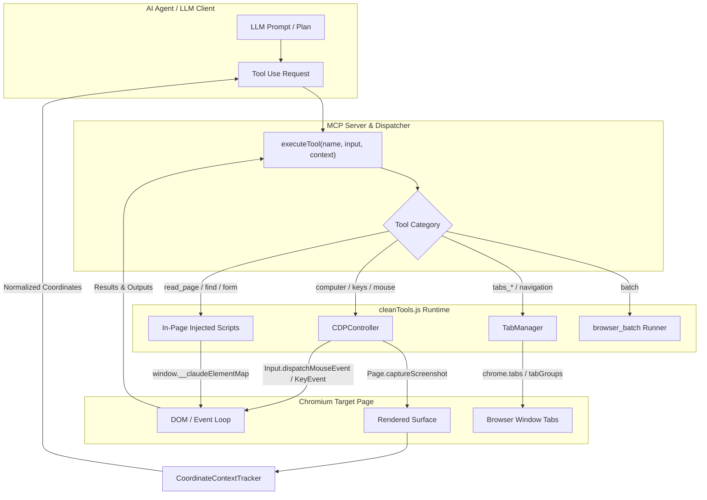
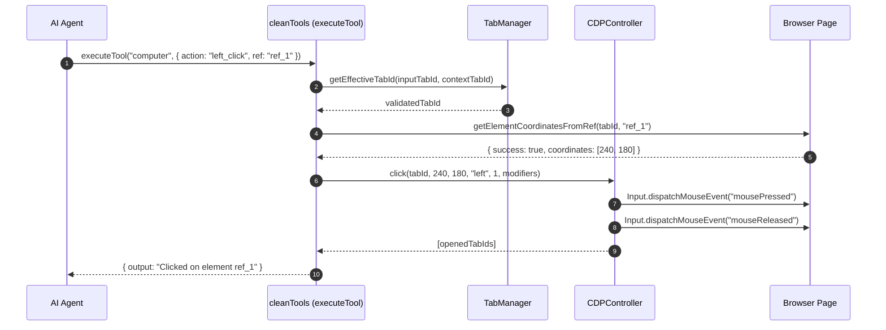

# Claude Browser Automation Extension & MCP Tools Specification

This document provides a comprehensive technical specification for AI agents and developers implementing or integrating the browser automation toolset in [`cleanTools.js`](file:///D:/coding/Auto%20Resume/claude/cleanTools.js).

---

## 1. System Overview

The system bridges an AI agent (running via Claude Desktop MCP, sidepanel extension, or standalone automation worker) to a live Chromium-based browser session. It combines:
1. **Chrome DevTools Protocol (CDP)** for low-level input simulation (hardware mouse clicks, dragging, scrolling, key chords) and deep inspection (network requests, console logs, screencasting).
2. **Chrome Extensions APIs (`chrome.tabs`, `chrome.tabGroups`, `chrome.windows`)** for tab confinement, lifecycle management, and window sizing.
3. **In-Page Injected Scripts (`window.__generateAccessibilityTree`, `window.__claudeElementMap`)** for accessibility tree extraction, natural language element search, and programmatic DOM form manipulation.
4. **Safety & Permission Gating** to enforce domain blocklists, prevent unauthorized navigation, and request user approval for high-risk actions.



---

## 2. Architecture & Data Flow

### 2.1 The Execution Lifecycle
When an agent calls a tool:
1. **Input Validation**: Tool parameters are checked against strict schema boundaries (e.g., maximum dimensions, required properties, non-negative numbers). USE ZOD
2. **Tab Confinement Verification**:
   - `TabManager.getEffectiveTabId(targetTabId, contextTabId)` validates whether `targetTabId` belongs to the agent's designated tab group (`Claude (MCP)`).
   - If an agent attempts to manipulate tabs outside its group, a `TabConfinementError` is raised.
3. **Indicator State Management**:
   - Before active interaction (clicking, typing), `TabManager.setActiveIndicatorTab(tabId)` signals user attention.
   - For screenshots or tree reading, `TabManager.hideIndicatorForToolUse(tabId)` temporarily hides browser overlay badges so they don't pollute visual captures.
4. **Action Execution**:
   - Dispatches CDP commands via `CDPController` or executes isolated content scripts via `chrome.scripting.executeScript`.
5. **Coordinate Context Recording**:
   - Every screenshot caches viewport width, height, device pixel ratio, and physical capture dimensions in `CoordinateContextTracker`.
6. **Result Formatting & Truncation**:
   - Page text is capped at 50,000 characters; JavaScript outputs are capped at 51,200 characters (50 KB).
   - Sensitive credentials (tokens, passwords, cookies, authorization headers) are automatically redacted via `redactSensitiveData`.



---

## 3. Key Concepts & Subsystems

### 3.1 Coordinate Systems & Frame Scaling
The browser automation pipeline operates across two coordinate frames:
1. **Screenshot Frame (`screenshotWidth` x `screenshotHeight`)**: The pixel resolution of the image returned to the LLM.
2. **Viewport Frame (`viewportWidth` x `viewportHeight`)**: The CSS layout coordinates used by Chromium's CDP input dispatcher.

```
scaleX = viewportWidth / screenshotWidth
scaleY = viewportHeight / screenshotHeight
viewportX = Math.round(screenX * scaleX)
viewportY = Math.round(screenY * scaleY)
```

> [!IMPORTANT]
> When issuing coordinates to `left_click`, `hover`, `scroll`, or `left_click_drag`, the agent **must supply coordinates matching the screenshot frame**. `validateAndScaleCoordinate()` automatically converts them to viewport pixels. If a coordinate falls outside the frame bounds, a `coordinate_out_of_bounds` error is returned.

### 3.2 Element References (`ref_X`) vs Coordinates
- **DOM Element Map**: When `read_page` or `find` executes, interactive elements are assigned unique string identifiers (`ref_1`, `ref_2`, etc.) and stored in `window.__claudeElementMap` as `WeakRef` objects.
- **Reference Actions**: The agent can pass `ref` directly to:
  - `computer`: `left_click`, `right_click`, `double_click`, `triple_click`, `hover`, `scroll_to`
  - `form_input`: to fill or select form values
  - `upload_image` / `file_upload`: to target specific `<input type="file">` elements
- **Stale References**: If the DOM tree re-renders or navigates, the element in `WeakRef` will no longer be connected. Tools return `ref_stale`, instructing the agent to call `read_page` or `find` again.

### 3.3 Batch Execution (`browser_batch`)
`browser_batch` enables executing a sequence of actions in a single model turn:
- **Sequential Execution**: Halts immediately on the first sub-action error.
- **Atomic Context Scoping**: Coordinate transformations use `beginPendingScope()` and are only committed to the global tracker if the batch finishes without navigation errors.
- **Non-Nesting**: `browser_batch` cannot call `browser_batch`.

### 3.4 Page Navigation & `beforeunload` Protection
- When navigating via `navigate`, pages with unsaved changes may trigger a `"Leave site?"` dialog.
- By default (`force: false`), navigation is intercepted and blocked, returning `navigate_beforeunload_blocked`.
- The agent or user can override this by passing `force: true`.

---

## 4. Complete Tool Catalog

The 23 tools exported by [`cleanTools.js`](file:///D:/coding/Auto%20Resume/claude/cleanTools.js) are categorized into six functional groups:

### Group A: User Interaction & Automation
| Tool Name | Key Actions / Parameters | Description |
|---|---|---|
| [`computer`](file:///D:/coding/Auto%20Resume/claude/cleanTools.js#L968) | `action`, `coordinate`, `ref`, `text`, `duration`, `scroll_direction`, `scroll_amount`, `region`, `scale`, `repeat`, `modifiers` | Simulates mouse clicks, text typing, keyboard shortcuts, smooth dragging, mouse wheel scrolling, element scrolling, zoom crops, and screenshots. |
| [`browser_batch`](file:///D:/coding/Auto%20Resume/claude/cleanTools.js#L1318) | `actions: [{ name, input }]` | Executes a series of standalone tool operations in sequential order within one turn. |
| [`form_input`](file:///D:/coding/Auto%20Resume/claude/cleanTools.js#L1701) | `ref`, `value`, `tabId` | Sets values on dropdown selects, checkboxes, radios, ranges, dates, numbers, text inputs, and textareas. Automatically redacts passwords in return logs. |

### Group B: Page Inspection & Reading
| Tool Name | Key Actions / Parameters | Description |
|---|---|---|
| [`read_page`](file:///D:/coding/Auto%20Resume/claude/cleanTools.js#L1519) | `filter` ("all" \| "interactive"), `depth` (default 15), `ref_id`, `max_chars` (default 50,000) | Generates an accessibility tree representation of the DOM with element references (`ref_X`). |
| [`find`](file:///D:/coding/Auto%20Resume/claude/cleanTools.js#L1586) | `query`, `tabId` | Natural language locator that scans the accessibility tree via a fast sub-model to return up to 20 matching elements with references. |
| [`get_page_text`](file:///D:/coding/Auto%20Resume/claude/cleanTools.js#L1878) | `max_chars` (default 50,000), `tabId` | Extracts clean text content, prioritizing `<article>`, `<main>`, and editorial content bodies. |

### Group C: Tab & Group Management
| Tool Name | Key Actions / Parameters | Description |
|---|---|---|
| [`tabs_context`](file:///D:/coding/Auto%20Resume/claude/cleanTools.js#L1987) | *(none)* | Returns a formatted list of all tabs in the active window/group. |
| [`tabs_context_mcp`](file:///D:/coding/Auto%20Resume/claude/cleanTools.js#L2015) | `createIfEmpty: boolean` | Retrieves all tabs in the agent's MCP group (`Claude (MCP)`). Can initialize a fresh window and tab group if none exists. |
| [`tabs_create`](file:///D:/coding/Auto%20Resume/claude/cleanTools.js#L2062) | *(none)* | Creates a new tab at `chrome://newtab` in the active tab group. |
| [`tabs_create_mcp`](file:///D:/coding/Auto%20Resume/claude/cleanTools.js#L2102) | *(none)* | Creates a new tab at `chrome://newtab` inside the agent's MCP tab group. |
| [`tabs_close_mcp`](file:///D:/coding/Auto%20Resume/claude/cleanTools.js#L2158) | `tabId: integer` | Closes a tab within the MCP group. Fails if the tab is outside the managed group. |

### Group D: Developer, Network & Environment Inspection
| Tool Name | Key Actions / Parameters | Description |
|---|---|---|
| [`javascript_tool`](file:///D:/coding/Auto%20Resume/claude/cleanTools.js#L2232) | `action: "javascript_exec"`, `text`, `tabId` | Executes code in the page's REPL context with `await` support, returning values up to 50 KB with credential redaction. |
| [`read_console_messages`](file:///D:/coding/Auto%20Resume/claude/cleanTools.js#L2363) | `tabId`, `onlyErrors`, `clear`, `pattern`, `limit` (default 100) | Captures and filters live console outputs (`console.log`, warnings, exceptions, and stack traces). |
| [`read_network_requests`](file:///D:/coding/Auto%20Resume/claude/cleanTools.js#L2446) | `tabId`, `urlPattern`, `clear`, `limit` (default 100) | Inspects HTTP network requests (XHR, fetch, documents) captured via CDP `Network.enable`. |
| [`resize_window`](file:///D:/coding/Auto%20Resume/claude/cleanTools.js#L2527) | `width`, `height`, `tabId` | Resizes the tab's host window (bounds: 1x1 up to 8K resolution 7680x4320). |
| [`navigate`](file:///D:/coding/Auto%20Resume/claude/cleanTools.js#L1432) | `url`, `tabId`, `force` | Navigates to a URL or traverses browser history (`"back"` / `"forward"`). |

### Group E: Media & File Management
| Tool Name | Key Actions / Parameters | Description |
|---|---|---|
| [`file_upload`](file:///D:/coding/Auto%20Resume/claude/cleanTools.js#L2701) | `files: [{ data, name, mimeType }]`, `ref`, `tabId` | Injects files directly into `<input type="file">` elements using synthesized `DataTransfer` payloads (max 10 MB). |
| [`upload_image`](file:///D:/coding/Auto%20Resume/claude/cleanTools.js#L2651) | `imageId`, `ref` OR `coordinate`, `tabId`, `filename` | Attaches a previous screenshot or uploaded image to a file input or drags & drops it onto an arbitrary coordinate. |
| [`gif_creator`](file:///D:/coding/Auto%20Resume/claude/cleanTools.js#L2582) | `action` ("start_recording", "stop_recording", "export", "clear"), `options` | Records up to 50 automation frames and exports an animated GIF with visual click and action indicators. |

### Group F: Session & Workflow Planning
| Tool Name | Key Actions / Parameters | Description |
|---|---|---|
| [`update_plan`](file:///D:/coding/Auto%20Resume/claude/cleanTools.js#L2822) | `domains: string[]`, `approach: string[]` | Submits a high-level plan and target domains to the user for one-click session approval. |
| [`turn_answer_start`](file:///D:/coding/Auto%20Resume/claude/cleanTools.js#L2864) | *(none)* | Demarcates the boundary between tool execution and final conversational response. |
| [`shortcuts_list`](file:///D:/coding/Auto%20Resume/claude/cleanTools.js#L2879) | *(none)* | Queries saved prompt macros and automated workflows. |
| [`shortcuts_execute`](file:///D:/coding/Auto%20Resume/claude/cleanTools.js#L2916) | `shortcutId`, `command` | Spawns a dedicated sidepanel window to execute a stored workflow. |

---

## 5. Implementation Guide for Agents

### 5.1 Setting Up the Tool Runner
To integrate `cleanTools.js` into an agent host or MCP server:

```javascript
import {
  allTools,
  toolsByName,
  executeTool,
  getAllAnthropicSchemas,
  LIMITS
} from './cleanTools.js';

// 1. Export tool definitions to Anthropic API or MCP schema
const toolSchemas = getAllAnthropicSchemas();

// 2. Prepare execution context
const context = {
  tabId: 12345,                // Current active tab ID
  tabGroupId: 10,              // Current MCP tab group ID
  toolUseId: "call_abc123",    // Unique request ID
  availableTools: allTools,    // Required for browser_batch
  createAnthropicMessage: async ({ modelClass, maxTokens, messages }) => {
    // LLM sub-query handler (used by the 'find' tool)
    return await llmClient.messages.create({
      model: "claude-haiku-4-5-20251001",
      max_tokens: maxTokens,
      messages,
    });
  },
  onBatchProgress: ({ index, total, name, status }) => {
    console.log(`[Batch] Step ${index + 1}/${total} (${name}): ${status}`);
  }
};

// 3. Central Dispatch
async function handleAgentToolCall(toolName, toolArguments) {
  try {
    const result = await executeTool(toolName, toolArguments, context);
    return result;
  } catch (error) {
    return {
      error: error.message,
      errorCode: error.errorCode || "tool_execution_failed"
    };
  }
}
```

### 5.2 Best Practices for Autonomous Agents

1. **Start with Tab Discovery**: Always call `tabs_context_mcp` with `{ createIfEmpty: true }` at the beginning of a fresh task to obtain a valid working `tabId`.
2. **Combine Actions with `browser_batch`**: Whenever you can predict consecutive deterministic steps (e.g., clicking a field, typing text, pressing Return, and waiting/screenshotting), bundle them into `browser_batch`.
3. **Prefer `ref` Over Blind Coordinates**:
   - Call `read_page` or `find` to get element references (`ref_1`, `ref_2`).
   - Pass `ref` to `computer: left_click` or `form_input`. This prevents coordinate misalignment caused by dynamic layout shifts or responsive rendering.
4. **Inspect Errors Carefully**:
   - `coordinate_out_of_bounds`: Take a fresh screenshot; the page has scrolled or resized.
   - `ref_stale`: The DOM tree changed; call `read_page` or `find` to refresh element references.
   - `page_zoom_shortcut_unsupported`: Browser page zoom shortcuts (e.g. `cmd+=`) are blocked; use `computer: zoom` with a `region: [x0, y0, x1, y1]` instead.
   - `navigate_beforeunload_blocked`: A form on the page has unsaved changes. Either complete the form or re-issue `navigate` with `force: true`.
