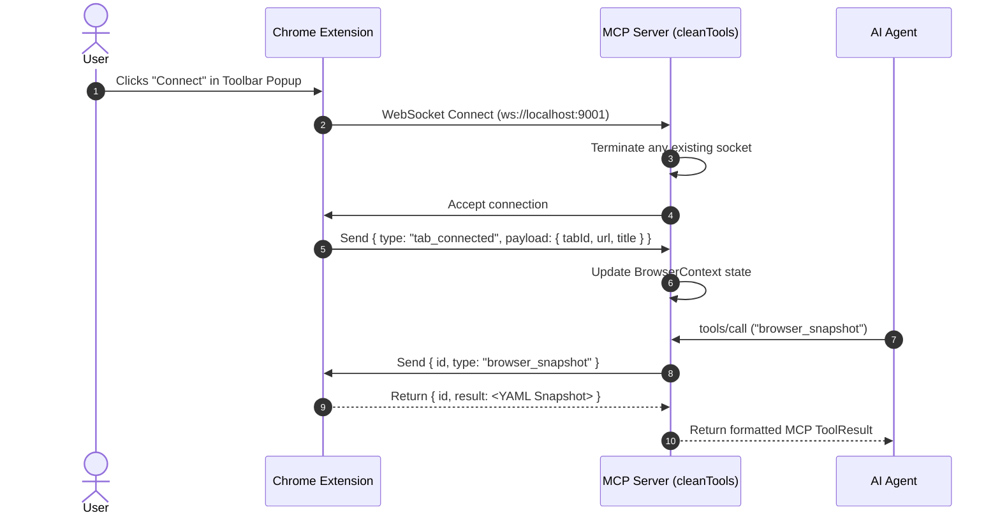
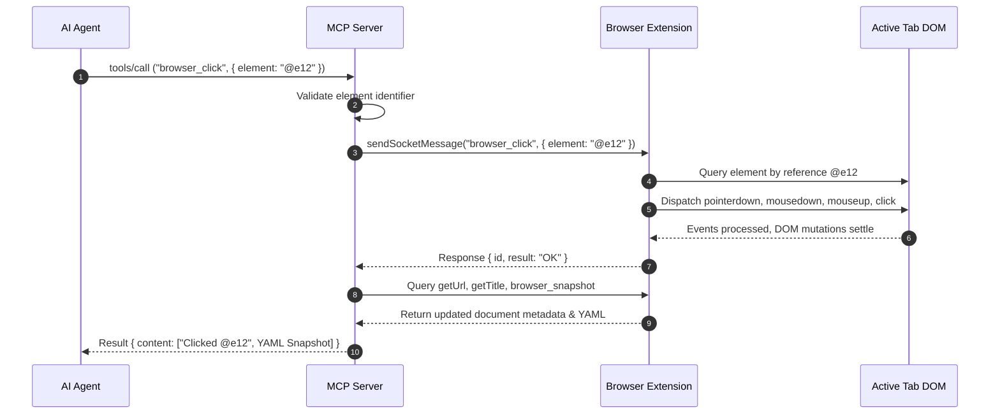

# Technical Specification: Browser MCP Automation Architecture

## 1. Executive Summary & Architectural Overview

The **Browser MCP Automation Engine** bridges AI agents and web browsers through the [Model Context Protocol (MCP)](https://modelcontextprotocol.io). Unlike headless browser frameworks (e.g., Puppeteer, Playwright) that launch isolated, ephemeral browser instances, Browser MCP attaches directly to the user's active browser profile. This architecture preserves logged-in sessions, authentic browser fingerprints, cookies, and local state while circumventing common anti-bot and CAPTCHA detection mechanisms.

The system is organized into a four-tier architecture:
1. **AI Agent / Client Application**: Interacts with the MCP server over standard input/output (`stdio`) using JSON-RPC 2.0.
2. **MCP Server (cleanTools.js)**: Manages tool registrations, input validation, execution orchestration, coordinate transformations, and batch transactions.
3. **WebSocket Communication Gateway**: Maintains duplex, asynchronous communication with the browser extension over a dedicated local port (`ws://localhost:9001`).
4. **Browser Extension (Chrome MV3)**: Injected background service worker and content scripts executing DOM manipulation, synthetic input dispatching, accessibility tree extraction, and tab tracking.

```
+-------------------+        stdio (JSON-RPC)       +-----------------------+
|     AI Agent      | <===========================> |     MCP Server        |
| (Claude / Windsurf|                               |   (cleanTools.js)     |
+-------------------+                               +-----------+-----------+
                                                                |
                                                    WebSocket   |  Port 9001
                                                    JSON-RPC    |  (Req/Res ID)
                                                                v
                                                    +-----------------------+
                                                    |   Chrome Extension    |
                                                    | (Background Worker)   |
                                                    +-----------+-----------+
                                                                |
                                                     Chrome API | CDP / DOM
                                                                v
                                                    +-----------------------+
                                                    |      Active Tab       |
                                                    |  (DOM, Aria, Canvas)  |
                                                    +-----------------------+
```

---

## 2. Multi-Tier Runtime Architecture & Components

### 2.1 MCP Server (`cleanTools.js`)
- **`BrowserContext`**: Manages the lifecycle of the WebSocket connection to the browser extension. Implements request-response multiplexing using cryptographically unique message UUIDs (`crypto.randomUUID()`) and configurable timeouts (default `30,000ms`).
- **`CoordinateTransformer`**: Normalizes and scales coordinates across physical screenshot frames, device pixel ratios (DPR), and CSS viewport coordinate spaces.
- **`ElementReferenceValidator`**: Enforces strict typing, sanitation, and validation rules for element identifiers, URLs, wait durations, and key events.
- **`BatchExecutionController`**: Orchestrates sequential multi-action pipelines within an isolated transaction scope, suppressing intermediate snapshots and providing fail-fast error isolation.
- **`ToolRegistry` & `MCPDispatcher`**: Exposes JSON Schema-compliant tool definitions and routes incoming MCP requests (`tools/list`, `tools/call`).

### 2.2 WebSocket Communication Gateway
- Runs on `localhost:9001` (configurable).
- Single-client exclusivity: Connecting a new tab automatically terminates existing connections to ensure atomic execution without cross-tab race conditions.
- Asynchronous correlation: Each packet carries `{ id, type, payload, timestamp }`. The server holds pending `Promise` instances resolved when a packet with a matching `id` returns.

### 2.3 Browser Extension (Client)
- **Background Service Worker**: Listens to Chrome extension lifecycle events, captures visible tab screenshots (`chrome.tabs.captureVisibleTab`), coordinates tab history (`chrome.tabs.goBack`, `chrome.tabs.goForward`), and relays messages to the content script.
- **Content Script**: Dispatches synthetic DOM events (clicks, mouse movements, keyboard typing) and builds the hierarchical Accessibility Tree snapshot.

---

## 3. End-to-End Data Flow & Sequence Workflows

### 3.1 Tab Connection & Handshake Flow


### 3.2 Action Execution Flow (e.g., Click with Auto-Snapshot)
When an agent invokes an interactive tool (such as `browser_click` or `browser_type`), the server executes the action and automatically captures a fresh snapshot of the updated document:



---

## 4. Coordinate Transformation System

Visual perception models (multimodal LLMs) inspect screenshot images, while the browser execution environment operates in CSS viewport pixels. Scaling discrepancies arise from **High-DPI / Retina displays**, zoom factors, and image cropping.

### 4.1 Coordinate Spaces
1. **Screenshot Frame Space ($S$)**: Physical pixel dimensions of the captured PNG image bitmap. For a 1920x1080 CSS viewport on a $2\times$ Retina display, the screenshot frame is $3840 \times 2160$ pixels.
2. **CSS Viewport Space ($V$)**: Logical pixel dimensions used by CSS, DOM element bounding boxes (`element.getBoundingClientRect()`), and simulated mouse events (`clientX`, `clientY`).
3. **Normalized Coordinate Space ($N$)**: Scale-independent space ranging from $[0, 1000]$ along both axes, widely utilized by vision-language models for coordinate grounding.

### 4.2 Mathematical Formulas

#### Device Pixel Ratio (DPR) Scaling:
$$\text{DPR} = \frac{\text{Physical Screen Pixels}}{\text{CSS Logical Pixels}} = \text{window.devicePixelRatio}$$

#### Screenshot Frame to CSS Viewport:
$$X_{\text{css}} = \left\lfloor \frac{X_{\text{frame}} + \text{offset}_x}{\text{DPR}} \right\rceil$$
$$Y_{\text{css}} = \left\lfloor \frac{Y_{\text{frame}} + \text{offset}_y}{\text{DPR}} \right\rceil$$

#### CSS Viewport to Screenshot Frame:
$$X_{\text{frame}} = \lfloor X_{\text{css}} \cdot \text{DPR} - \text{offset}_x \rceil$$
$$Y_{\text{frame}} = \lfloor Y_{\text{css}} \cdot \text{DPR} - \text{offset}_y \rceil$$

#### Normalization / Denormalization ($[0, 1000]$):
$$N_x = \left\lfloor \frac{X}{W} \cdot 1000 \right\rceil, \quad N_y = \left\lfloor \frac{Y}{H} \cdot 1000 \right\rceil$$
$$X = \left\lfloor \frac{N_x}{1000} \cdot W \right\rceil, \quad Y = \left\lfloor \frac{N_y}{1000} \cdot H \right\rceil$$

### 4.3 Pointer Event Dispatching with Coordinates
When clicking or hovering via coordinates:
- If explicit `{ coordinates: { x, y } }` are passed, coordinates are interpreted as CSS viewport pixels.
- The extension performs hit-testing via `document.elementFromPoint(x, y)` to verify the target element before dispatching `MouseEvent` or CDP synthetic touch/pointer events.

---

## 5. Element Referencing & Resolution Engine

Browser MCP avoids fragile CSS selectors (such as auto-generated Tailwind or CSS module hashes) by constructing a semantic **Accessibility Tree Snapshot** serialized as YAML.

### 5.1 Snapshot Schema & Structure
```yaml
- RootWebArea "GitHub" [focused]
  - banner
    - link "Homepage": /
    - navigation
      - link "Pull requests": /pulls
      - link "Issues": /issues
  - main
    - heading "Sign in to GitHub" [level: 1]
    - textbox "Username or email address" [id: @e12]
    - textbox "Password" [id: @e13, type: password]
    - button "Sign in" [id: @e14]
```

### 5.2 Resolution Hierarchy
When an agent provides an `element` parameter, the content script evaluates the identifier using the following priority order:
1. **Explicit Reference ID (`@e<index>` / `<index>`)**: Direct lookup in the cached node map generated during the most recent accessibility scan.
2. **Semantic Role & Accessible Name**: Evaluated using ARIA roles and labels, e.g., `role=button[name="Sign in"]` or `button "Sign in"`.
3. **Standard CSS Selector**: Validated via `document.querySelector(selector)` (e.g., `#login-btn`, `input[name="q"]`).
4. **XPath Expression**: Evaluated via `document.evaluate(...)` when the string starts with `//` or `xpath=`.

---

## 6. Batch Execution & Transaction Scoping

Complex web interactions often require multiple sequential operations (e.g., selecting an input field, clearing text, typing a search query, and pressing Enter). 

### 6.1 Performance Bottleneck: Intermediary Snapshots
Capturing an accessibility snapshot involves DOM traversal, serialization, and transmission over WebSocket (generating between 2KB and 100KB of YAML). In standard execution, running 4 actions requires 4 round-trips and 4 separate snapshot payloads, consuming large portions of the AI agent's context window.

### 6.2 Transaction Scoping via `browser_batch`
The `browser_batch` tool executes multiple actions sequentially within an atomic execution scope:

```json
{
  "name": "browser_batch",
  "arguments": {
    "actions": [
      { "tool": "browser_click", "params": { "element": "@e12" } },
      { "tool": "browser_type", "params": { "element": "@e12", "text": "agent@example.com" } },
      { "tool": "browser_click", "params": { "element": "@e14" } }
    ],
    "stopOnError": true
  }
}
```

### 6.3 Transaction Guarantees:
1. **Snapshot Suppression**: Intermediary steps omit snapshot generation.
2. **Fail-Fast Boundary**: If Step $k$ fails (e.g., element not found, navigation timeout), subsequent steps ($k+1 \dots N$) are aborted immediately.
3. **Diagnostic Capture**: Upon failure or completion, a single snapshot is generated containing diagnostic state, current URL, and document title.
4. **Consolidated Log**: Returns an itemized report of every action attempted, status (`SUCCESS` / `FAILED`), and error details.

---

## 7. Complete MCP Tool Catalog

| Tool Name | Parameters | Auto Snapshot | Description |
|---|---|---|---|
| `browser_navigate` | `url` (string, required) | Yes | Loads target URL into active tab. |
| `browser_go_back` | None | Yes | Navigates backwards in session history. |
| `browser_go_forward`| None | Yes | Navigates forward in session history. |
| `browser_wait` | `time` (number, required) | No | Pauses execution for $N$ seconds (max 300). |
| `browser_press_key` | `key` (string, required) | No | Sends keyboard event to active element. |
| `browser_snapshot` | None | Yes | Captures full page URL, title, and YAML Aria snapshot. |
| `browser_click` | `element`, `button?`, `clickCount?`, `coordinates?` | Yes | Clicks on target element or coordinate. |
| `browser_hover` | `element`, `coordinates?` | Yes | Hovers cursor over target element. |
| `browser_type` | `element`, `text`, `clearValue?`, `delay?` | Yes | Types text into input or editable element. |
| `browser_drag` | `startElement`, `endElement`, `startCoordinates?`, `endCoordinates?` | Yes | Drags source element and drops onto destination. |
| `browser_select_option` | `element`, `values` (array) | Yes | Selects options in `<select>` element. |
| `browser_screenshot` | `fullPage?`, `clip?` | No | Captures visual PNG screenshot as base64. |
| `browser_get_console_logs` | None | No | Retrieves recorded browser console logs. |
| `browser_batch` | `actions` (array), `stopOnError?` | Final only | Executes compound operations with error isolation. |

---

## 8. Agent Dispatcher Integration Template

The following production template demonstrates how an autonomous AI agent integrates with the `cleanTools.js` engine:

```javascript
/**
 * AgentDispatcher.js - Production-ready Autonomous Agent Loop
 */

import { BrowserContext, ToolRegistry, MCPDispatcher, CoordinateTransformer } from "./cleanTools.js";
import { WebSocketServer } from "ws";

export class BrowserAgentDispatcher {
  constructor(options = {}) {
    this.port = options.port || 9001;
    this.context = new BrowserContext();
    this.registry = new ToolRegistry();
    this.dispatcher = new MCPDispatcher(this.context, this.registry);
    this.wss = null;
  }

  /**
   * Initializes WebSocket listener and awaits extension connection.
   */
  async start() {
    this.wss = new WebSocketServer({ port: this.port });
    console.log(`[BrowserAgentDispatcher] WebSocket listening on port ${this.port}`);

    this.wss.on("connection", (ws) => {
      console.log("[BrowserAgentDispatcher] Browser extension connected.");
      this.context.ws = ws;
    });
  }

  /**
   * Main autonomous reasoning loop.
   * @param {string} taskGoal - High-level objective (e.g. "Search for laptop prices")
   * @param {Function} llmCompletion - Function that invokes the LLM with system prompt + history
   */
  async runTask(taskGoal, llmCompletion) {
    if (!this.context.hasWs()) {
      throw new Error("No browser extension connected. Please connect a tab before running tasks.");
    }

    console.log(`[BrowserAgentDispatcher] Starting task: "${taskGoal}"`);
    let isComplete = false;
    let stepCount = 0;
    const maxSteps = 20;

    // Initial environment observation
    let currentObservation = await this.registry.execute("browser_snapshot", this.context);

    while (!isComplete && stepCount < maxSteps) {
      stepCount++;
      console.log(`\n--- Step ${stepCount} ---`);

      // 1. Prepare agent prompt with current tools and page snapshot
      const prompt = {
        goal: taskGoal,
        step: stepCount,
        observation: currentObservation.content[0]?.text,
        tools: this.registry.listSchemas(),
      };

      // 2. Query Model for next action
      const decision = await llmCompletion(prompt);

      if (decision.type === "finish") {
        console.log(`[Task Complete]: ${decision.summary}`);
        isComplete = true;
        break;
      }

      // 3. Execute chosen tool
      console.log(`[Executing Tool]: ${decision.toolName}`, decision.arguments);
      const executionResult = await this.registry.execute(
        decision.toolName,
        this.context,
        decision.arguments
      );

      // 4. Update observation
      currentObservation = executionResult;

      if (executionResult.isError) {
        console.warn(`[Action Warning]: Step resulted in error: ${executionResult.content[0]?.text}`);
      }
    }

    if (!isComplete) {
      console.warn(`[Terminated]: Reached maximum step limit of ${maxSteps} without explicit finish.`);
    }
  }

  async stop() {
    await this.context.close();
    if (this.wss) {
      await new Promise((resolve) => this.wss.close(resolve));
    }
    console.log("[BrowserAgentDispatcher] Stopped.");
  }
}
```

---

## 9. Error Handling & Recovery Matrix

| Scenario | Symptom / Error Code | Root Cause | Automatic Remediation |
|---|---|---|---|
| Extension Not Connected | `NO_TAB_CONNECTED` | User has not clicked "Connect" in toolbar or browser closed. | Throws actionable user message prompting extension toolbar connection. |
| Tool Timeout | `TIMEOUT` (30s) | Heavy network load, infinite redirect, or unresponsive alert dialog. | Cancels pending promise, clears listener, and captures current tab URL. |
| Element Not Found | `INVALID_ARGUMENTS` | Stale reference ID from previous page load or mutation. | Re-triggers `browser_snapshot` to refresh accessibility tree and retry. |
| Stale Connection | `DISCONNECTED` | User refreshed target tab or navigated across origins. | Background controller cleans up dangling requests and awaits re-handshake. |
