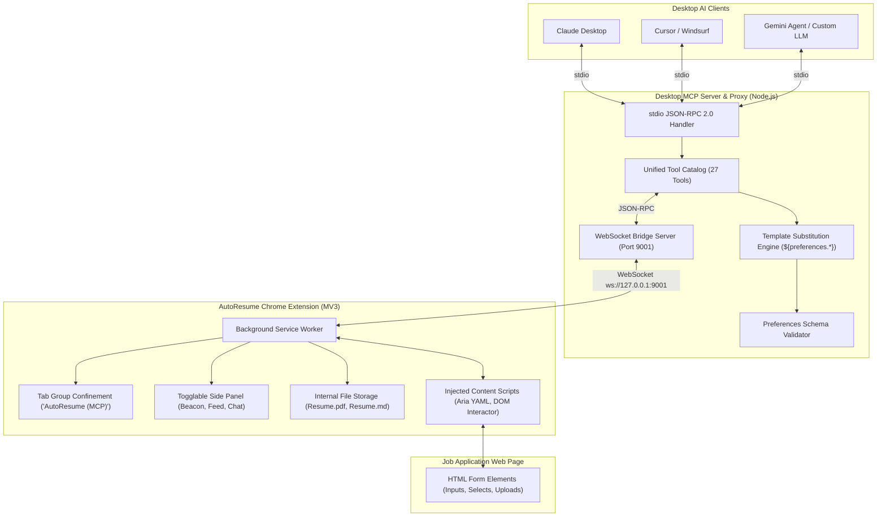

# AutoResume: Browser MCP Tool & Job Application Engine

An autonomous browser automation system and **Model Context Protocol (MCP)** toolset engineered to fill out job application forms (Workday, Greenhouse, Lever, Ashby, Taleo, BambooHR, etc.) with human-like fidelity, precision, and zero-hallucination guarantees.

---

## Architecture Overview



---

## 3 Core Components

### 1. Browser Extension (`main/extension/`)
- **Manifest V3** compliant with `sidePanel`, `tabGroups`, `debugger`, `scripting`, and `storage` permissions.
- **Side Panel**:
  - **Connection Beacon Animation**: Visual pulsing radar indicating connection status and awaiting agent requests.
  - **Top Statistics Strip**: Live counters for Tools Called, Active Tab ID, and Exported/Imported Files.
  - **Live Activity Feed**: Real-time log of tools called on the active page, hover timestamps with exact date/time tooltips, expandable argument previews, and distinct grouped cards for `browser_batch` calls.
  - **Extension Internal Storage**: Holds `Resume.pdf`, `Resume.md`, and `preference.json` ready for one-click reference or direct DOM file upload injection.
  - **Inbuilt AI Chat Wrapper**: Standalone browser-native agent supporting **Gemini**, **Claude**, **OpenAI**, and **Ollama**. Connect via account or API key to autofill forms directly from the browser without running external desktop software!
- **Tab Confinement**: Automatically groups the active job application tab into `AutoResume (MCP)` with purple branding, isolating automation away from personal tabs.

### 2. Desktop Host MCP Server & Proxy (`main/mcp-server/`)
- Standard **JSON-RPC 2.0** Model Context Protocol server over `stdio`.
- **WebSocket Bridge**: Listens on `ws://127.0.0.1:9001` (configurable via `MCP_WS_PORT`) and proxies commands to the Chrome Extension.
- **Template Substitution Engine**: Automatically resolves placeholders such as `${preferences.general.firstName}` or `${preferences.education[0].institution}` from `preference.json` before commands reach the browser.
- **Schema Validation & Update Tools**: Built-in `validate_preferences_schema`, `update_preferences_section`, and `get_preferences` tools for real-time profile maintenance.

### 3. AI Skill & Preferences Schema (`main/skill/` & `main/preferences/`)
- **`preferences.schema.json`**: Strict JSON Schema specifying General Info, Education Details, Awards, Experiences, Projects, Skills, Demographics, and Custom QA.
- **`preference.json`**: Populated profile extracted directly from `Resume.md` and `Resume.pdf` (for Himanshu Sultania).
- **`SKILL.md`**: Complete step-by-step instructions for AI agents:
  - Observation protocol: 1 DOM Accessibility Tree snapshot + 1 screenshot.
  - Natural human simulation: hover $\rightarrow$ focus/click $\rightarrow$ type with realistic delay (20-40ms) $\rightarrow$ brief transition pause (100-300ms).
  - Maximum batching via `browser_batch`.
  - Zero hallucination policy: prompt user for missing fields using pointers only.
  - Verification pass and structured final work summary.

---

## Quickstart Guide

### 1. Install Chrome Extension
1. Open Google Chrome (or Brave / Edge) and navigate to `chrome://extensions/`.
2. Enable **Developer mode** (toggle in upper right corner).
3. Click **Load unpacked** and select the folder:
   ```
   D:\coding\Auto Resume\main\extension
   ```
4. Click the AutoResume icon in your browser toolbar or press `Alt+A` to open the side panel.

---

### 2. Configure Desktop AI Clients (MCP)

#### Claude Desktop
Add AutoResume to your `claude_desktop_config.json`:
- **Windows**: `%APPDATA%\Claude\claude_desktop_config.json`
- **macOS**: `~/Library/Application Support/Claude/claude_desktop_config.json`

```json
{
  "mcpServers": {
    "autoresume": {
      "command": "node",
      "args": [
        "D:\\coding\\Auto Resume\\main\\mcp-server\\src\\index.js"
      ]
    }
  }
}
```

#### Cursor / Windsurf
Under MCP Settings, add a new server:
- **Type**: `command`
- **Command**: `node "D:/coding/Auto Resume/main/mcp-server/src/index.js"`

---

### 3. Or Use the Inbuilt Browser Chat Wrapper
If you prefer not to configure desktop software:
1. Open any job application page.
2. Open the AutoResume side panel (`Alt+A`).
3. Click the **Inbuilt AI Chat** tab.
4. Select your provider (**Gemini**, **Claude**, **OpenAI**, or **Ollama**), input your API key, and click **Connect Provider**.
5. Click **🚀 Fill Out This Application** or converse directly with the agent!

---

## Tool Catalog Summary (27 Tools)

| Tool Name | Parameters | Description |
|---|---|---|
| `browser_navigate` | `url`, `force`, `tabId` | Navigates tab to URL or traverses history (`"back"` / `"forward"`). |
| `browser_snapshot` | `filter`, `depth`, `tabId` | Returns Accessibility Tree serialized as YAML with `@eX` handles. |
| `browser_screenshot` | `fullPage`, `tabId` | Captures high-res PNG screenshot with coordinate metadata. |
| `browser_click` | `element`, `coordinates`, `button`, `clickCount` | Clicks target element or coordinate. |
| `browser_hover` | `element`, `coordinates`, `tabId` | Hovers cursor over target element. |
| `browser_type` | `element`, `text`, `clearValue`, `delay` | Types text with human-like delay and `${preferences.*}` resolution. |
| `browser_press_key` | `key`, `modifiers`, `tabId` | Sends keyboard key event (e.g. `Enter`, `Tab`, `Escape`). |
| `browser_select_option` | `element`, `values`, `tabId` | Selects option in `<select>` dropdown. |
| `browser_wait` | `time` | Pauses execution for $N$ seconds (human pacing / DOM settling). |
| `browser_drag` | `startElement`, `endElement`, `startCoordinates`, `endCoordinates` | Drags and drops elements or coordinates. |
| `form_input` | `ref`, `value`, `tabId` | Directly sets values in form elements (text, select, radio, checkbox, date). |
| `file_upload` | `ref`, `fileName`, `files`, `tabId` | Injects files (e.g. `Resume.pdf`) into file input elements. |
| `browser_batch` | `actions`, `stopOnError`, `tabId` | Executes atomic multi-action sequences with intermediate suppression. |
| `tabs_context` | *(none)* | Lists tabs in active window. |
| `tabs_context_mcp` | `createIfEmpty` | Lists or initializes tabs in `AutoResume (MCP)` group. |
| `tabs_create` | `url` | Creates a new tab inside MCP tab group. |
| `tabs_close` | `tabId` | Closes a tab within MCP group. |
| `browser_get_console_logs` | `onlyErrors`, `limit`, `tabId` | Retrieves browser console logs. |
| `browser_get_network_requests` | `urlPattern`, `limit`, `tabId` | Inspects captured HTTP network requests. |
| `javascript_exec` | `text`, `tabId` | Evaluates JavaScript in page REPL with credential redaction. |
| `validate_preferences_schema` | `section`, `preferences` | Validates preferences against schema. |
| `update_preferences_section` | `section`, `data`, `overwrite` | Updates and persists data into `preference.json`. |
| `get_preferences` | `path` | Retrieves value from `preference.json` by dot-path. |

---

## Verifying the Installation

Run the automated MCP validation test:
```bash
node "D:/coding/Auto Resume/main/mcp-server/src/index.js"
```
Or test preferences validation:
```bash
npm --prefix "D:/coding/Auto Resume/main" run validate:prefs
```
