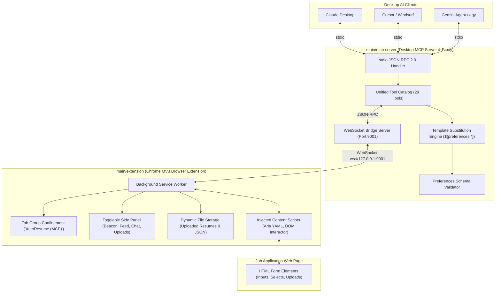

# AutoResume: Browser MCP Tool & Job Application Engine

An autonomous browser automation system and **Model Context Protocol (MCP)** toolset engineered to fill out job application forms (Workday, Greenhouse, Lever, Ashby, Taleo, BambooHR, etc.) with human-like fidelity, precision, and zero-hallucination guarantees.

> [!IMPORTANT]
> **Dynamic Initialization (No Preloaded Data)**: AutoResume does **not** assume that any resume (`Resume.pdf`, `Resume.md`) or applicant preferences (`preference.json`) exist on disk or preloaded in `main`. Preferences and application assets are supplied dynamically by the user (uploading via the Chrome extension side panel) or extracted dynamically by the AI agent.

---

## Architecture Overview

---

## 3 Core Components

### 1. Browser Extension (`main/extension/`)
- **Manifest V3** compliant with `sidePanel`, `tabGroups`, `debugger`, `scripting`, and `storage` permissions.
- **Side Panel**:
  - **Connection Beacon Animation**: Visual pulsing radar indicating connection status and awaiting agent requests.
  - **Top Statistics Strip**: Live counters for Tools Called, Active Tab ID, and Stored Files.
  - **Live Activity Feed**: Real-time log of tools called on the active page, hover timestamps with exact date/time tooltips, expandable argument previews, direct file links for screenshots, and grouped cards for `browser_batch` operations.
  - **Dynamic File Storage**: Users can click **+ Upload File** to select their Resume (`.pdf`, `.md`) or Preferences (`.json`). The extension parses and validates JSON preferences, stores base64 file blobs, and syncs them automatically to the MCP server.
  - **Inbuilt AI Chat Wrapper**: Standalone browser-native agent supporting **Gemini**, **Claude**, **OpenAI**, and **Ollama**. Connect via account or API key to autofill forms directly from the browser without running external desktop software!
- **Tab Confinement**: Automatically groups the active job application tab into `AutoResume (MCP)` with purple branding, isolating automation away from personal tabs.

### 2. Desktop Host MCP Server & Proxy (`main/mcp-server/`)
- Standard **JSON-RPC 2.0** Model Context Protocol server over `stdio`.
- **WebSocket Bridge**: Listens on `ws://127.0.0.1:9001` (configurable via `MCP_WS_PORT`) and proxies commands to the Chrome Extension.
- **Template Substitution Engine**: Automatically resolves placeholders such as `${preferences.general.firstName}` or `${preferences.education[0].institution}` once preferences are initialized.
- **Dynamic Profile Management**:
  - `set_preferences`: Initializes candidate data in memory, validating against `preferences.schema.json`.
  - `get_preferences`: Queries active preferences (returns clear error if not yet initialized).
  - `update_preferences_section`: Merges new user answers into active preferences.
  - `store_file` / `list_files`: Dynamically registers and tracks application files for DOM injection.

### 3. AI Skill & Preferences Schema (`main/skill/` & `main/preferences/`)
- **`preferences.schema.json`**: Strict JSON Schema specifying General Info, Education Details, Awards, Experiences, Projects, Skills, Demographics, and Custom QA.
- **`validator.js`**: Reusable validator engine enforcing schema rules and performing dot-path lookups.
- **`SKILL.md`**: Complete step-by-step instructions for AI agents:
  - **Phase 0**: Dynamic initialization — prompt user for resume, parse into schema, call `set_preferences`.
  - **Phase 1**: Tab discovery and verification within `AutoResume (MCP)` group.
  - **Phase 2**: Dual observation: 1 DOM Accessibility Tree snapshot + 1 screenshot.
  - **Phase 3**: Natural human simulation: hover $\rightarrow$ focus/click $\rightarrow$ type with realistic delay (20-40ms) $\rightarrow$ brief transition pause (100-300ms) with `browser_batch`.
  - **Phase 4**: Zero hallucination policy: prompt user for missing fields using pointers only.
  - **Phase 5**: Verification pass and structured final work summary.

---

## Dynamic Initialization Flows

AutoResume supports two flexible paths to provide resume and preference data:

### Path A: User Uploads in Browser Extension
1. Open any job application page.
2. Open the AutoResume side panel (`Alt+A`).
3. Click the **Files & Resume** tab $\rightarrow$ click **+ Upload File**.
4. Select your resume (`.pdf` or `.md`) or an existing preferences file (`.json`).
5. If you upload a `.json` file matching the schema, the extension automatically activates it and synchronizes it to the MCP server.

### Path B: AI Agent Extracts Resume from Chat
1. In Claude Desktop, Cursor, or `agy`, prompt the agent:
   > *"Here is my resume: [paste text or attach resume]. Please initialize my preferences and fill out the job application on my active browser tab."*
2. The agent parses the resume into the standardized schema and calls `set_preferences({ preferences: parsedData })`.
3. Template substitutions are immediately activated, and the agent proceeds to fill the form.

---

## Tool Catalog Summary (29 Tools)

| Tool Name | Parameters | Description |
|---|---|---|
| `set_preferences` | `preferences`, `source` | Initializes candidate preferences dynamically in the MCP engine. |
| `get_preferences` | `path` | Retrieves value from active preferences by dot-path (or returns uninitialized status). |
| `update_preferences_section` | `section`, `data`, `overwrite` | Updates or merges data into a section of active preferences. |
| `validate_preferences_schema` | `section`, `preferences` | Validates a preferences object or section against the official schema. |
| `store_file` | `name`, `data`, `mimeType`, `description` | Registers a file (e.g. resume PDF) in session storage for web form injection. |
| `list_files` | *(none)* | Lists all files currently stored or uploaded in session storage. |
| `browser_navigate` | `url`, `force`, `tabId` | Navigates tab to URL or traverses history (`"back"` / `"forward"`). |
| `browser_snapshot` | `filter`, `depth`, `tabId` | Returns Accessibility Tree serialized as YAML with `@eX` handles. |
| `browser_screenshot` | `fullPage`, `tabId` | Captures high-res PNG screenshot with coordinate metadata. |
| `browser_click` | `element`, `coordinates`, `button`, `clickCount` | Clicks target element or coordinate. |
| `browser_hover` | `element`, `coordinates`, `tabId` | Hovers cursor over target element. |
| `browser_type` | `element`, `text`, `clearValue`, `delay` | Types text with human-like delay and `${preferences.*}` resolution. |
| `browser_press_key` | `key`, `modifiers`, `tabId` | Sends keyboard key event (e.g. `Enter`, `Tab`, `Escape`). |
| `browser_select_option` | `element`, `values`, `tabId` | Selects option in `<select>` dropdown. |
| `browser_wait` | `time` | Pauses execution for $N$ seconds (human pacing / DOM settling). |
| `browser_drag` | `startElement`, `endElement`, `startCoordinates`, `endCoordinates` | Drags and drops elements or coordinates. |
| `form_input` | `ref`, `value`, `tabId` | Directly sets values in form elements (text, select, radio, checkbox, date). |
| `file_upload` | `ref`, `fileName`, `files`, `tabId` | Injects files (e.g. stored resume) into file input elements. |
| `browser_batch` | `actions`, `stopOnError`, `tabId` | Executes atomic multi-action sequences with intermediate suppression. |
| `tabs_context` | *(none)* | Lists tabs in active window. |
| `tabs_context_mcp` | `createIfEmpty` | Lists or initializes tabs in `AutoResume (MCP)` group. |
| `tabs_create` | `url` | Creates a new tab inside MCP tab group. |
| `tabs_close` | `tabId` | Closes a tab within MCP group. |
| `browser_get_console_logs` | `onlyErrors`, `limit`, `tabId` | Retrieves browser console logs. |
| `browser_get_network_requests` | `urlPattern`, `limit`, `tabId` | Inspects captured HTTP network requests. |
| `javascript_exec` | `text`, `tabId` | Evaluates JavaScript in page REPL with credential redaction. |
