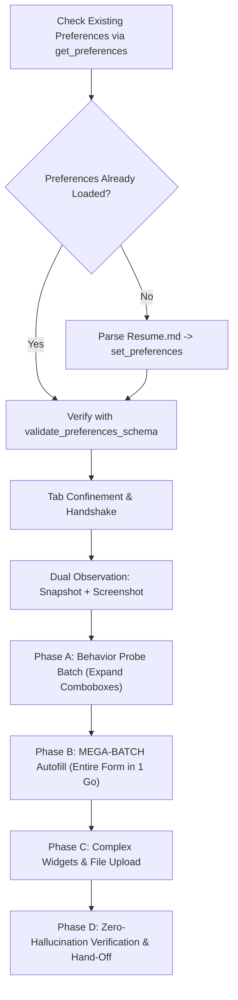

# AI Skill: Autonomous Browser Job Application Autofill Agent

## 1. Skill Overview & Purpose

This AI skill defines the high-efficiency protocol and reasoning process for an autonomous AI agent utilizing the **Browser MCP Tool** to fill out job application forms (Workday, Greenhouse, Lever, Ashby, Taleo, BambooHR, iCIMS, SmartRecruiters, etc.) with maximum speed, zero hallucination, and human-like precision.



---

## 2. Operational Directives

1. **Tool Output Handling & Step Logs**:
   - When large tool responses (such as comprehensive `browser_snapshot` trees) are written to step output files (e.g., in `.system_generated/steps/<id>/output.txt`), you **MAY** read or search the step output file with `read_file` or targeted string search to extract element reference IDs (`@e...`).
2. **NO Piecemeal Click-and-Wait Loops**:
   - Never perform individual single-click $\rightarrow$ snapshot $\rightarrow$ script $\rightarrow$ single-click cycles.
   - Follow the **Behavior Probe Batch $\rightarrow$ Mega-Batch** pipeline to minimize tool round-trips.
3. **Zero Hallucination Policy**:
   - Never claim a field or demographic disclosure (Gender, Race, Veteran status, Disability) was selected unless verified.
   - For modern styled forms (Greenhouse, Lever, etc.), checkboxes and radio choices are triggered via their `<label for="...">` or clickable button wrappers.
   - If an answer is not in the candidate's preferences (e.g. "How did you hear about this role?"), preserve it for the user under **User Actions Remaining**.
4. **CAPTCHA Boundary**:
   - If a CAPTCHA challenge is detected, surface it under **User Actions Remaining** — do not attempt to automate it.
5. **Zero Pre-Batch Micro-Testing & Fast Transition**:
   - Never perform isolated single-element test mutations, exploratory React fiber probe loops, or trial option selections prior to the Mega-Batch.
   - As soon as field handles, option keys, and label selectors are identified (via snapshot or a single schema inspection pass), transition immediately to Phase 4 (Mega-Batch).
   - Trust the Three-Tier Action Hierarchy (Stage 1 direct input + Stage 2 label/option clicks + Stage 3 state fallback) to execute simultaneously in one unified batch without pre-validating individual widgets.

---

## 3. Phase-by-Phase Execution Protocol

### Phase 0: Check Existing Preferences & Smart Resume Initialization
1. **Always check existing preferences first**:
   - Call `get_preferences({})`.
   - If preferences are already loaded and populated (e.g., `general.fullName` or `general.firstName` and `general.email` exist):
     - Call `validate_preferences_schema({})`.
     - If valid, **reuse the existing preferences directly** — do NOT re-parse `Resume.md` or overwrite preferences unnecessarily.
2. **Only if preferences are empty or missing**:
   - Read the candidate's resume from `Resume.md`.
   - Extract personal details, education, experience, projects, skills, and work authorization.
   - Call `set_preferences({ preferences: candidateData })` to activate template substitutions (`${preferences.*}`).
   - Call `validate_preferences_schema({})` to verify compliance.

---

### Phase 1: Tab Confinement & Host Recognition
1. Call `tabs_context` or `tabs_context_mcp` to identify the active tab in the `AutoResume (MCP)` tab group.
2. Check the URL host (e.g. Greenhouse, Lever, Ashby, Workday) to apply known ATS field patterns.

---

### Phase 2: Dual Observation Pass (DOM + Vision)
1. Call `browser_snapshot({ "depth": 30, "filter": "interactive" })` to generate semantic element references (`@e1`, `@e2`, etc.).
   *(If the tree output is written to a step file due to size, read that step output to map the IDs).*
2. Call `browser_screenshot({})` once to visually survey the form layout, required indicators (`*`), and section boundaries.
3. Classify detected fields into:
   - **Static Inputs**: Text boxes, textareas, email, phone, city, LinkedIn/GitHub URLs $\rightarrow$ designated for `form_input`.
   - **Dynamic / "Sus" Elements**: Dropdowns/comboboxes that do not expose options until clicked (Country, State, Major, Degree, Year) and styled label checkboxes/radios.

---

### Phase 3: Behavior Probe Batch (Learn Dynamic Form Behavior)
If comboboxes or dropdowns hide their option lists until clicked:
1. Construct a targeted `browser_batch` or single inspection pass:
   - Click suspicious combobox triggers (`browser_click`) to expand listboxes/popovers into the DOM, OR extract option keys directly in one query.
   - Include a brief settle wait: `browser_wait({ time: 0.1 })`.
2. Follow immediately with a single `browser_snapshot({ "filter": "interactive" })`.
3. **Hard Stop**: Do NOT test-set individual fields or query React internals iteratively. Proceed directly to **Phase 4 (Mega-Batch Autofill)**.

---

### Phase 4: Mega-Batch Autofill (One Huge Batch for the Whole Form)
With all element handles, option references, and label selectors now in hand, execute **ONE COMPREHENSIVE `browser_batch`** that fills the entire form in one operation:

1. **Three-Tier Action Hierarchy**:
   - **Stage 1 (Primary Preference — Direct Form Input)**:
     Use `form_input` for all text fields, textareas, and native inputs with template variables:
     ```json
     { "tool": "form_input", "params": { "ref": "@e17", "value": "${preferences.general.email}" } }
     ```
   - **Stage 2 (Secondary Preference — Clickable Labels & Discovered Options)**:
     - For comboboxes: `browser_click` the discovered option element (`@e...`).
     - For styled checkboxes and radios (Gender, Race, Veteran, Disability): `browser_click` the associated `<label for="...">` or option element reference.
     - Insert a natural pause between major sections: `browser_wait({ time: 0.05 })`.
   - **Stage 3 (Tertiary Fallback — JavaScript Execution)**:
     Use `javascript_exec` only for shadow DOM or stubborn custom rich-text widgets where Stage 1 and Stage 2 cannot reach.

---

### Phase 5: Complex Widgets & Attachments
Handle any remaining tricky elements individually:
1. **File Uploads**:
   - For Resume or Cover Letter dropzones, call `file_upload({ fileName: "Resume.pdf" })`.
   - Do NOT use `browser_click` on native file inputs.
2. **Search-and-Select Popups**:
   - If a combobox required typing before options appeared (e.g. university search), handle that single element cleanly.
3. **Multi-Step Forms**:
   - If a "Next" / "Continue" button appears, click it to advance, but NEVER click the final "Submit Application".

---

### Phase 6: Zero-Hallucination Verification & Hand-Off
1. Take a final `browser_snapshot` to verify actual input values and checked states.
2. Check for any validation error banners or `aria-invalid="true"`.
3. Do NOT click the final "Submit" button.
4. Output your response strictly using this two-section format:

```markdown
### Work Completed
- [Pointers detailing fields and sections populated with verified values]

### User Actions Remaining
- [Pointers for unmapped questions e.g. "How did you find out about this opportunity?"]
- [Pointers for manual verification of disclosures, CAPTCHA, and final submission]
```
