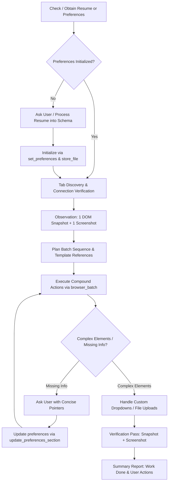

# AI Skill: Autonomous Browser Job Application Autofill Agent

## 1. Skill Overview & Purpose

This AI skill defines the exact protocol and reasoning process for an autonomous AI agent utilizing the **Browser MCP Tool** to fill out job application forms (Workday, Greenhouse, Lever, Ashby, Taleo, BambooHR, iCIMS, SmartRecruiters, etc.) with human-like fidelity, precision, and adherence to user preferences.

> [!IMPORTANT]
> **No Preloaded Data**: The AI agent **must not** assume that `preference.json` or `Resume.pdf` is pre-existing on disk or preloaded in the environment. All preferences and resumes are provided dynamically by the user (either uploaded via the extension side panel or provided directly in the chat).



---

## 2. Phase-by-Phase Execution Protocol

### Phase 0: Dynamic Initialization & Resume Processing
1. **Check Existing Preferences**:
   - Call `get_preferences` and `list_files` to check if the user has already uploaded preferences or resume files in the extension.
2. **If Not Initialized**:
   - **Do not guess or assume defaults.**
   - Prompt the user to provide their resume (by pasting text in chat or uploading `.pdf` / `.md` via the extension's **Files & Resume** tab).
   - Once the resume content is available, extract all personal details, education history, awards, experiences, projects, technical skills, and work authorization.
   - Construct the structured preferences object conforming strictly to `preferences.schema.json`.
   - Call `set_preferences({ preferences: candidateData })` to load the profile into the MCP runtime.
   - If a resume file was provided, call `store_file({ name: "Resume.pdf", data: base64 })`. The MCP server immediately synchronizes the file to the Chrome Extension so `file_upload` can access it.
3. Call `validate_preferences_schema` to guarantee 100% compliance.

---

### Phase 1: Tab Confinement & Handshake
1. Retrieve open browser tabs via `tabs_context` or `tabs_context_mcp`.
2. Ensure the active application page is located inside the designated tab group (`AutoResume (MCP)`).
3. Check the connection status beacon in the side panel. Proceed only when the connection is confirmed active.
4. Avoid navigating or switching tabs outside the designated tab group.

---

### Phase 2: Dual Observation (DOM + Vision)
Before performing any mutation or typing on a new page or section:
1. **DOM Read**: Call `browser_snapshot` (or its alias `read_page`) to generate the semantic Accessibility Tree. This creates unique element identifiers (`@e1`, `@e2`, or `ref_1`, `ref_2`) and detects element roles (textbox, combobox, radio, checkbox, button).
2. **Vision Read**: Call `browser_screenshot` once to observe the overall visual layout, progress indicators, required field asterisks (`*`), validation error banners, and section headers.
3. Build a mental map connecting visual elements to their corresponding reference IDs.

---

### Phase 3: Compound Batch Execution & Human Simulation
Job application portals frequently employ behavioral telemetry, bot-detection heuristics, and event listeners that expect standard human interaction flows.

#### 1. Maximum Batching (`browser_batch`)
- Group all deterministic, consecutive form actions into a single `browser_batch` invocation.
- Do NOT perform single-field round-trips for standard forms. A single batch should comfortably complete an entire logical section (e.g., Personal Contact Information, Education, or Employment).

#### 2. Human-Like Action Sequences
For every interactive field, adhere strictly to the natural typing and clicking flow:
```
1. Click / focus the element: browser_click({ element: "@e12" })
2. Type text with simulated cadence: browser_type({ element: "@e12", text: "...", delay: 20 })
3. Brief natural transition pause (50ms - 150ms): browser_wait({ time: 0.1 })
```

#### 3. Default to Preference Template References
- Whenever inputting data present in the applicant's profile, **reference the preference path directly** using template syntax:
  - Example: `"${preferences.general.firstName}"`
  - Example: `"${preferences.general.lastName}"`
  - Example: `"${preferences.general.phone.formatted}"`
  - Example: `"${preferences.education[0].institution}"`
  - Example: `"${preferences.education[0].graduationDate}"`
- The MCP server automatically resolves template paths at runtime. If an optional property is absent from preferences, it resolves to an empty string to prevent raw tokens from being typed into forms.
- **Direct string override**: If the form demands an unusual date or phone format (e.g. `YYYY/MM/DD` instead of `MM/DD/YYYY`, or unformatted 10 digits `8142065539`), format and supply the string directly.

#### 4. Section Sequencing
- **Top-to-Bottom, Left-to-Right**: Complete fields in the visual order a human user would follow.
- **Save Complex Elements for Last**: Leave complex widgets (e.g., custom React/Vue select dropdowns with virtualized search popups, file upload dropzones, rich-text cover letter editors, reCAPTCHA / Cloudflare checks) until all standard inputs are filled.

---

### Phase 4: Missing Information & Ambiguity Handling
1. **Zero Hallucination Policy**:
   - If a form asks a question whose answer cannot be derived with certainty from preferences (e.g., "Expected salary", "Willing to relocate?", "How did you hear about this opening?"):
   - **DO NOT GUESS OR INVENT ANSWERS.**
   - Skip the field temporarily and collect all ambiguous questions.
2. **Concise User Inquiries (Pointers Only)**:
   - Present the missing questions to the user in a concise, bulleted format:
     - `• Question: [Exact field label] — Suggested answer based on context, or awaiting your input.`
3. **Persist User Responses**:
   - Once the user answers, invoke `update_preferences_section` to store the response in `customQA` or the relevant section so future applications can answer automatically.

---

### Phase 5: Verification & Final Hand-Off
1. After all form sections are filled, run a final verification pass:
   - `browser_snapshot`: Confirm that all inputs contain the expected values and no validation error messages (`aria-invalid="true"`, `"This field is required"`) are displayed.
   - `browser_screenshot`: Visually confirm all radio toggles, checkboxes, and attachments are attached.
2. **File Uploads**:
   - For resume and cover letter upload fields, use `file_upload` with `fileName: "Resume.pdf"` (from stored files) or inline base64 data.
   - Do NOT click on native file inputs with `browser_click` as native OS file dialogs cannot be interacted with via DOM scripts.
3. **Never Submit Without Human Consent**:
   - Stop at the final "Review" or "Submit Application" button.
4. **Summary Report**:
   - Conclude with a clean Markdown report strictly adhering to the two-section format:
     ```markdown
     ### Work Completed
     - Filled Personal Information (First Name, Last Name, Email, Phone, Address, Links).
     - Filled Education (Degree, Institution, Dates, GPA).
     - Uploaded Resume (`Resume.pdf`).
     - Selected Work Authorization preferences.

     ### User Actions Remaining
     - Review voluntary demographic and diversity self-identification disclosures.
     - Review attached resume preview in the portal.
     - Click the final "Submit Application" button.
     ```
